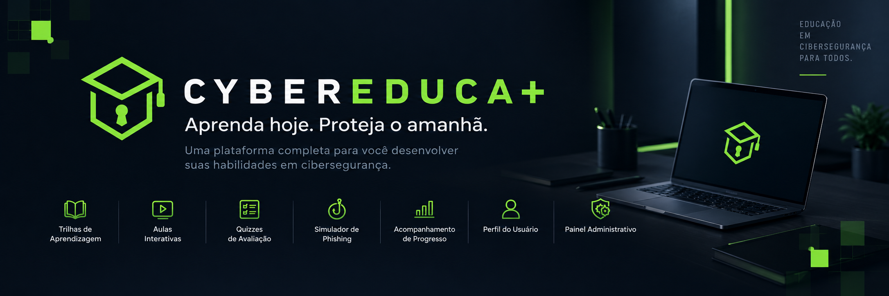
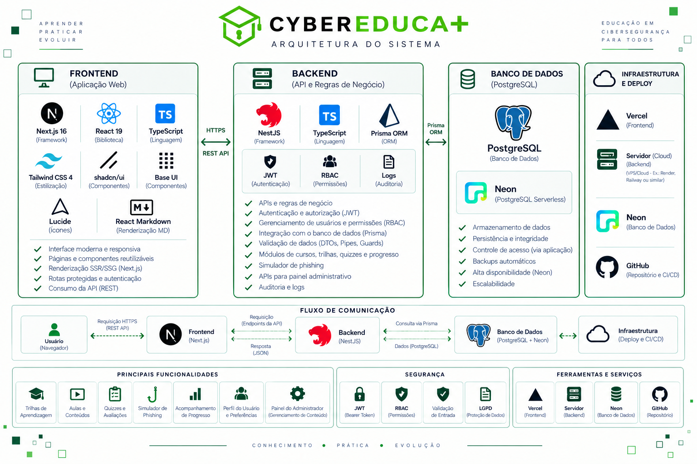

# CyberEduca+

> Plataforma web de aprendizagem em cibersegurança, com trilhas, quizzes e simulador de phishing — desenvolvida como Projeto Final de Curso (PFC) na UMC.




## Sobre o projeto


Desenvolvido como **Projeto Final de Curso (PFC)** da **Universidade de Mogi das Cruzes - UMC**, para os cursos de Bacharelado em Engenharia de Software e Bacharelado em Sistemas de Informação.

À medida que os ciberataques (phishing, golpes, força bruta) se tornam mais frequentes, cresce a necessidade de capacitação prática em segurança digital. O **CyberEduca+** propõe um site educacional com trilhas de aprendizagem, aulas, quizzes de avaliação e um simulador de phishing, incluindo autenticação de usuário, perfil básico e um painel administrativo para gestão de conteúdos e acompanhamento de desempenho.

**Fora do escopo do MVP:** aplicativo mobile e push. Google OAuth pode ser habilitado por ambiente.

<br clear="right"/>

## Objetivo

Oferecer uma ferramenta prática e acessível de capacitação em cibersegurança, na qual o usuário aprende por meio de trilhas de conteúdo, valida o conhecimento com quizzes e treina a identificação de ameaças reais através de um simulador de cenários de phishing, com acompanhamento contínuo do seu progresso.

## Integrantes

| Integrante | Nome completo | RGM |
|---|---|---|
| Aluno 1 | Luís Felipe Penninck Dos Santos | 11231101140 |
| Aluno 2 | Caio Miranda do Nascimento | 11231101833 |
| Aluno 3 | Thiago dos Santos Soares | 11221101451 |

**Orientador(a):** Alessandro Aparecido da Silva Horas

## Atores do Sistema

- **Administrador:** gerencia trilhas, aulas, quizzes, cenários de phishing e usuários da plataforma pelo painel administrativo.
- **Usuário:** realiza trilhas e aulas, responde quizzes, pratica no simulador de phishing e acompanha sua evolução e histórico de desempenho.

## Funcionalidades

- Trilhas de aprendizagem, aulas e conteúdos
- Acompanhamento de progresso por trilha
- Quizzes de múltipla escolha com correção e feedback
- Histórico de desempenho e resultados
- Simulador de cenários de phishing com classificação e análise de sinais de risco
- Cadastro, login/logout e perfil do usuário (com gerenciamento de preferências)
- Seção de notícias sobre cibersegurança, com artigos ilustrando ameaças reais
- Navegação entre as áreas do sistema
- Painel administrativo (dashboard, gerenciamento de trilhas, quizzes, phishing e usuários)

## Arquitetura



O front-end (**Next.js**) consome a API REST do back-end (**NestJS**) via HTTPS, com autenticação por **JWT**. O back-end aplica regras de negócio, autenticação/autorização (JWT), controle de permissões (**RBAC**), validação de dados (DTOs, Pipes, Guards) e auditoria (logs), além de gerenciar os módulos de cursos, trilhas, quizzes, progresso e o simulador de phishing. A comunicação com o banco de dados é feita através do **Prisma ORM**, conectado ao **PostgreSQL** hospedado no **Neon** (PostgreSQL Serverless). O front-end é publicado na **Vercel**, e o back-end em um servidor cloud (VPS/Cloud), com repositório e CI/CD no **GitHub**.

**Fluxo de comunicação:** Usuário (navegador) → Frontend (Next.js) → Requisição REST (Backend NestJS) → Consulta via Prisma → Banco de Dados (PostgreSQL + Neon) → Infraestrutura (Deploy e CI/CD).

## Stack Tecnológica

| Camada | Tecnologias |
|---|---|
| **Front-end** | Next.js 16, React 19, TypeScript, Tailwind CSS 4, shadcn/ui, Base UI, Lucide (ícones), React Markdown |
| **Back-end** | Node.js, NestJS, TypeScript, JWT (autenticação), RBAC (permissões), validação de DTOs, Logs (auditoria) |
| **Banco de Dados** | PostgreSQL, Prisma ORM, Neon (PostgreSQL Serverless) |
| **Deploy** | Vercel (front-end), Servidor Cloud (back-end — ex.: Render, Railway ou similar), Neon (banco de dados), GitHub (repositório e CI/CD) |
| **Qualidade** | Oxlint, Jest, testes unitários e de integração |

## Como rodar o projeto localmente

### Pré-requisitos

- Node.js (LTS) e npm
- PostgreSQL (local ou uma URL de conexão remota, ex.: Neon)

### 1. Back-end

```bash
cd backend
npm install
cp .env.example .env   # preencher com a senha do banco (DATABASE_URL)
```

Crie um banco PostgreSQL local chamado `cybereduca` e rode as migrations:

```bash
npx prisma migrate dev
npm run db:seed        # carrega os dados iniciais
npm run start:dev
```

A API sobe em `http://localhost:3000`.

### 2. Front-end

```bash
cd frontend
npm install
cp .env.local.example .env.local
npm run dev
```

O frontend sobe em `http://localhost:3001` (o CORS da API já está liberado para essa porta).

## Metodologia

Desenvolvimento em **Scrum**, com gestão de tarefas via Monday e comunicação da equipe via Discord/WhatsApp. Modelagem com UML (casos de uso e classes), DER e prototipação de interfaces (Figma).

## Segurança e LGPD

Modelo de segurança planejado para o MVP (parte ainda em implementação — ver [Status do Projeto](#-status-do-projeto)):

- Autenticação via JWT (Bearer Token)
- Hash de senhas
- Controle de acesso por perfil (RBAC — usuário/administrador)
- Validação de entrada
- Auditoria e logs
- Tratamento de dados pessoais conforme a LGPD (Lei nº 13.709/2018)

## Status do Projeto

Projeto em desenvolvimento ativo, seguindo o cronograma do PFC (2026).

- [x] Definição de escopo e arquitetura
- [x] Modelagem inicial de dados
- [x] Módulo de trilhas e aulas 
- [x] JWT e RBAC implementados
- [x] Quizzes implementados
- [x] Simulador de phishing
- [x] Painel administrativo
- [ ] Dashboards de desempenho (a página de progresso do frontend já consome a API, mas segue em evolução)
- [x] Testes automatizados

## Licença e uso de dados

O uso de bibliotecas, APIs e demais recursos de terceiros é identificado e documentado no projeto. O tratamento de dados pessoais, quando existente, observa os princípios e requisitos legais e institucionais aplicáveis.

## Instituição

Projeto desenvolvido para a **Universidade de Mogi das Cruzes - UMC** · Mogi das Cruzes - SP, 2026.

## Controles e manutenção

- POST/PATCH de trilhas e aulas exigem JWT e perfil ADMIN. Alunos autenticados podem concluir aulas.
- POST `/auth/login` permite 5 tentativas por e-mail e 30 por IP por janela de 15 minutos. Todas as tentativas contam, inclusive logins válidos. O excesso retorna HTTP 429 e `Retry-After` em segundos. A auditoria das credenciais inválidas permanece no serviço de autenticação.
- Os contadores ficam em memória por processo e reiniciam com a API. Múltiplas instâncias precisam de armazenamento compartilhado. O IP vem do Express; configure proxies confiáveis de acordo com a infraestrutura antes de aceitar cabeçalhos encaminhados.
- O painel apresenta indicadores de usuários, trilhas e aulas, distribuição dos conteúdos e desempenho por prova.
- `StatusProva` usa RASCUNHO, PUBLICADO e ARQUIVADO. A migration `20261113120000_unificar_status_prova` converte os valores antigos preservando as provas. Aplique com `npm run deploy` no backend e gere o cliente com `npx prisma generate` antes de iniciar a nova versão.

### Verificação

No backend: `npm test -- --runInBand` e `npm run build`. No frontend: `npx tsc --noEmit` e `npm run build`.

### Pendências opcionais

Históricos completos de quizzes e phishing, feedback individual nas provas e gestão dos cenários de phishing continuam como melhorias opcionais. Existem resultados salvos de quizzes e phishing, feedback de quizzes e uma tela administrativa de simulações; essas funcionalidades não cobrem todas as interfaces opcionais.

### Simulações práticas

A listagem de simulações reúne os cenários de phishing existentes e treinos de contas, dispositivos, privacidade, redes, resposta a incidentes e código seguro. Mostra até quatro cartões por página, com imagens, dificuldade e navegação por setas.

No backend, aplique a migration `20261114150000_simulacoes_completas`, gere o cliente Prisma e execute `npm run db:seed:simulacoes`. A importação adiciona 12 treinos com 36 decisões e preserva conteúdos e resultados existentes. Ela também faz parte de `npm run db:seed:activities`.

Os treinos têm nível, duração, contexto fictício e explicação por decisão, editáveis no painel administrativo. A API corrige as respostas no servidor, rejeita respostas incompletas, duplicadas ou de outra simulação e salva o feedback detalhado para consulta posterior. Resultados antigos continuam disponíveis com seu placar original.

Com a API local ativa, `npm run db:verify:simulacoes` verifica os 12 treinos usando contas fictícias temporárias, removidas ao final. O script não utiliza contas reais. Para outro endereço de API, configure `SIMULATION_TEST_API` no ambiente do comando.
