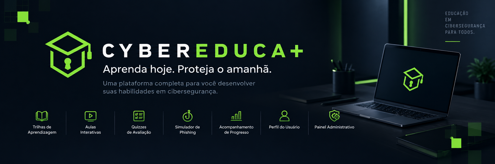
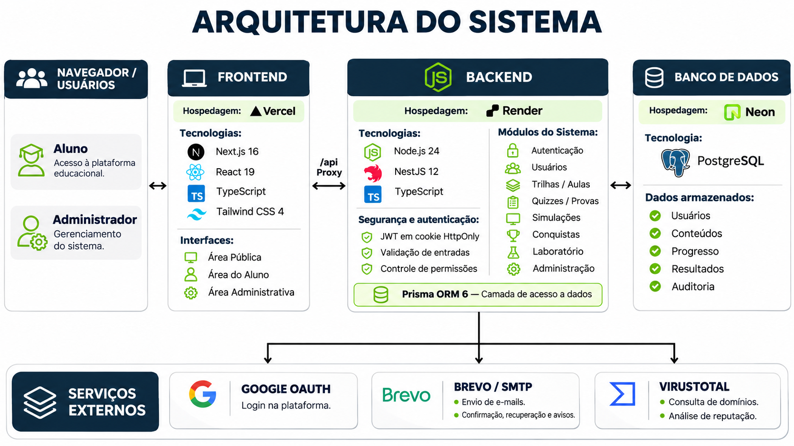

# CyberEduca+

> Plataforma web de aprendizagem em cibersegurança, desenvolvida como Projeto Final de Curso (PFC) na Universidade de Mogi das Cruzes — UMC.




**Site:** [cybereduca.vercel.app](https://cybereduca.vercel.app)

## Índice

- [Sobre o projeto](#sobre-o-projeto)
- [Integrantes](#integrantes)
- [Funcionalidades](#funcionalidades)
- [Arquitetura e tecnologias](#arquitetura-e-tecnologias)
- [Executar localmente](#executar-localmente)
- [Verificação](#verificação)
- [Instruções e evidências de execução](#instruções-e-evidências-de-execução)
- [Segurança e privacidade](#segurança-e-privacidade)
- [Organização do repositório](#organização-do-repositório)
- [Documentação complementar](#documentação-complementar)
- [Metodologia](#metodologia)
- [Uso acadêmico e recursos de terceiros](#uso-acadêmico-e-recursos-de-terceiros)

## Sobre o projeto


O CyberEduca+ reúne trilhas, aulas, quizzes, provas por nível, simulações e um laboratório de consulta de domínios. O aluno estuda, pratica, acompanha seu progresso e conquista insígnias. O administrador gerencia os conteúdos e acompanha os resultados da plataforma.

O projeto foi finalizado como PFC dos cursos de Bacharelado em Engenharia de Software e Bacharelado em Sistemas de Informação da UMC. A interface web é responsiva, com navegação adaptada para computadores e celulares.

**Objetivo:** oferecer capacitação acessível em segurança da informação, aproximando os conteúdos de situações do cotidiano e permitindo acompanhar a evolução do aprendizado.

<br clear="right"/>

## Integrantes

| Nome completo | RGM |
|---|---|
| Luís Felipe Penninck Dos Santos | 11231101140 |
| Caio Miranda do Nascimento | 11231101833 |
| Thiago dos Santos Soares | 11221101451 |

**Orientador:** Alessandro Aparecido da Silva Horas.

## Funcionalidades

### Aluno

- Cadastro e login com senha, seguido de confirmação por link de uso único enviado por e-mail.
- Entrada com Google, quando a integração está configurada no ambiente.
- Recuperação de senha por e-mail.
- Dashboard com progresso e acesso à próxima aula.
- Trilhas organizadas nos níveis básico, intermediário e avançado, com percurso horizontal e acompanhamento das aulas concluídas.
- Aulas com textos, materiais de apoio, mídias e atividades conforme o conteúdo cadastrado.
- Provas ao final de cada nível: conclusão das aulas e aprovação com pelo menos 60% de acertos para conquistar a insígnia e liberar o nível seguinte.
- Nova tentativa de prova após 24 horas em caso de reprovação.
- Quizzes com correção e feedback.
- Simulações de phishing e outros cenários de segurança, com decisões, correção no servidor e resultados salvos. O catálogo exibe até oito simulações por página.
- Laboratório para consulta de domínios com integração ao VirusTotal.
- Perfil com conquistas e indicadores de desempenho; configurações de nome, e-mail, foto, avatar e senha, além de exclusão da conta.

### Administração

- Dashboard com indicadores de usuários, trilhas, aulas, atividades e desempenho educacional.
- Gestão de usuários, trilhas, aulas, quizzes, provas e simulações.
- Publicação e arquivamento de conteúdos conforme o módulo.
- Consulta de resultados e histórico de operações administrativas.
- Acesso restrito à conta administradora oficial, com validação de permissões no backend.

### Área pública

- Página inicial com apresentação da plataforma e notícias de cibersegurança.
- Páginas Sobre, Ajuda, Termos de Uso e Política de Privacidade.
- Banner de boas-vindas na primeira visita à página inicial; o navegador lembra seu fechamento.
- Escolha de cookies opcionais, com possibilidade de aceitar, rejeitar e alterar a decisão posteriormente. A preferência controla o armazenamento local das celebrações de conquistas já exibidas.

## Arquitetura e tecnologias

### Visão geral

O CyberEduca+ adota uma **arquitetura cliente-servidor organizada em três camadas**: apresentação, aplicação (regras de negócio) e dados. Essas classificações se complementam: cliente-servidor descreve a comunicação entre o navegador e os serviços; três camadas descreve a divisão de responsabilidades.



| Camada | Responsabilidade | Implementação |
|---|---|---|
| Apresentação | Interface pública, área do aluno e administração | Next.js e React, publicados na Vercel |
| Aplicação | API REST, autenticação, autorização e regras de negócio | Backend NestJS, publicado no Render |
| Dados | Persistência de conteúdos, usuários, progresso, resultados e auditoria | PostgreSQL, hospedado no Neon |

O backend é um **monólito modular**: os módulos de negócio compõem uma única aplicação NestJS. Internamente, controllers recebem requisições, DTOs validam entradas, guards controlam o acesso e services aplicam as regras de negócio. O Prisma integra a aplicação como camada de acesso ao PostgreSQL.

O navegador acessa a interface, e as chamadas REST em JSON passam pelo proxy `/api` do Next.js até o backend. O banco não é acessado diretamente pelo navegador. Google OAuth, envio de e-mails e VirusTotal são integrados pelo backend; esses serviços externos complementam as três camadas.

### Frontend — Vercel

- Interface em Next.js 16, React 19 e TypeScript, com estilos em Tailwind CSS 4 e CSS.
- Reúne a área pública, o ambiente do aluno e o painel administrativo, com navegação responsiva.
- Encaminha as requisições de `/api` para o backend por meio do proxy configurado no Next.js.
- Compartilha consultas idênticas simultâneas no navegador, sem manter as respostas concluídas em um cache permanente.

### Backend — Render

- API REST em NestJS 12 e TypeScript, executada em Node.js 24.
- Organiza autenticação, usuários, trilhas, aulas, quizzes, provas, simulações, laboratório, conquistas e administração.
- Valida as entradas, verifica as permissões, aplica os critérios de desbloqueio e realiza a correção das atividades.
- Utiliza Passport e JWT para autenticação, bcrypt para hash de senhas e registros de auditoria das operações.
- Mantém os gabaritos no servidor e representa os exercícios de phishing em cenários fictícios de treinamento, sem executar ataques reais.

### Persistência — Prisma e PostgreSQL

- O Prisma ORM 6 integra o backend como camada de acesso a dados; não é um serviço independente.
- O PostgreSQL armazena usuários, conteúdos, progresso, tentativas, respostas, resultados e registros de auditoria.
- O banco de produção está hospedado no Neon. O ambiente local utiliza a conexão definida em `DATABASE_URL`.
- As migrações versionadas mantêm a estrutura e as atualizações do banco.

### Integrações externas

| Serviço | Responsabilidade |
|---|---|
| Google OAuth | Autenticação com a conta Google |
| Brevo (API HTTP) ou SMTP | Envio dos links de confirmação de login e recuperação de senha; produção configurada com Brevo |
| VirusTotal | Consulta de relatórios de segurança de domínios; não recebe URLs completas nesse fluxo |

### Fluxo de uma requisição

1. O usuário acessa a interface no navegador e solicita uma ação.
2. O frontend envia a requisição para `/api`, encaminhada ao backend.
3. Nas operações protegidas, o backend valida o JWT recebido no cookie HttpOnly e as permissões da conta.
4. O backend aplica as regras de negócio e consulta o PostgreSQL por meio do Prisma ou a integração necessária à operação.
5. A API retorna a resposta ao frontend, que atualiza a interface.

### Tecnologias e publicação

| Camada | Tecnologias e serviços |
|---|---|
| Frontend | Next.js 16, React 19, TypeScript, Tailwind CSS 4, CSS, Base UI, shadcn, Lucide, React Markdown e Recharts |
| Backend | Node.js 24, NestJS 12, TypeScript, Passport, JWT, bcrypt e validação de DTOs |
| Dados | PostgreSQL e Prisma ORM 6; banco de produção no Neon |
| Integrações | Google OAuth, Brevo ou SMTP para e-mails e VirusTotal para consulta de domínios |
| Publicação | Vercel para o frontend e Render para o backend |
| Qualidade | Jest, testes de integração HTTP, verificações do frontend e Oxlint; GitHub Actions em pull requests para a main |

## Executar localmente

### Requisitos

- Node.js 24, conforme [.nvmrc](./.nvmrc), e npm.
- PostgreSQL e um banco criado para a aplicação.
- Configuração de envio de e-mail para concluir o login com senha e a recuperação de acesso.

Execute os comandos de cada serviço em terminais separados. Os exemplos abaixo usam PowerShell.

### Backend

Antes da primeira execução, crie `backend/.env` a partir de [backend/.env.example](./backend/.env.example) e configure `DATABASE_URL`, `JWT_SECRET`, `FRONTEND_URL` e o envio de e-mails. Use Brevo ou SMTP; o login depende da entrega do link de confirmação. Google OAuth e VirusTotal exigem suas próprias credenciais para habilitar essas integrações.

```powershell
cd backend
npm install
npx prisma generate
npx prisma migrate deploy
npm run start:dev
```

A API utiliza `http://localhost:3002` por padrão. A variável `PORT` permite alterar a porta.

`npx prisma migrate deploy` aplica as migrações pendentes, incluindo as atualizações versionadas do catálogo. Não altere migrações já aplicadas. Os comandos `db:seed` são ferramentas de importação e manutenção; o seed geral também atualiza conteúdos e estrutura das trilhas, portanto não deve ser executado indiscriminadamente em produção.

### Frontend

Antes da primeira execução, crie `frontend/.env.local` a partir de `frontend/.env.local.example`, com `BACKEND_URL=http://localhost:3002`, ou o endereço correspondente à sua API.

```powershell
cd frontend
npm install
npm run dev
```

O site fica disponível em `http://localhost:3001`.

Mais detalhes do backend estão em [backend/README.md](./backend/README.md).

## Verificação

Na pasta `backend`:

```powershell
npm test -- --runInBand
npm run lint
npm run build
```

Para os testes de integração, configure `.env.test.local` conforme [backend/.env.test.example](./backend/.env.test.example) e execute `npm run test:integracao`. O executor exige PostgreSQL local e cria um banco temporário, separado do banco da aplicação.

Na pasta `frontend`:

```powershell
npx tsc --noEmit --incremental false
npm run build
node scripts/test-inflight-requests.cjs
node scripts/test-request-loading.cjs
node scripts/test-mobile-public-menu.cjs
node scripts/test-admin-dashboard.cjs
node scripts/test-admin-lesson-editor.cjs
```

As verificações do frontend cobrem requisições, carregamento, navegação mobile, cálculos do dashboard e edição de aulas. Outros scripts de verificação estão em `frontend/scripts` e `backend/scripts`.

## Instruções e evidências de execução

### Preparação da demonstração

1. Executar o backend e o frontend conforme [Executar localmente](#executar-localmente), ou acessar o [site publicado](https://cybereduca.vercel.app).
2. Preparar uma conta de aluno exclusiva para demonstração, com dados fictícios e uma caixa de e-mail de teste controlada pela equipe. Para os fluxos administrativos, utilizar o acesso autorizado, sem divulgar suas credenciais.
3. Configurar o serviço de envio de e-mail. Para demonstrar Google OAuth e VirusTotal, configurar também as respectivas integrações no ambiente.
4. Identificar a versão apresentada com `git branch --show-current` e `git rev-parse HEAD`. Registrar esses dados junto à data, ao ambiente e às evidências da demonstração.

### Roteiro de verificação das funcionalidades

| Funcionalidade | Passos para execução | Resultado esperado e evidência a registrar |
|---|---|---|
| Cadastro e validação | Abrir `/cadastro`, tentar enviar campos inválidos e depois cadastrar a conta de demonstração com dados válidos | Mensagens de validação e confirmação do cadastro; capturar as mensagens sem expor os dados da conta |
| Login e confirmação por e-mail | Abrir `/login`, informar as credenciais e confirmar o acesso pelo link recebido | Acesso à área do aluno após confirmação; registrar o fluxo ocultando endereço, link e token |
| Recuperação de senha | Abrir `/esqueci-senha`, solicitar a recuperação e definir uma nova senha pelo link recebido | Acesso com a nova senha; registrar as confirmações sem mostrar senhas ou links de recuperação |
| Trilhas, aulas e progresso | Abrir `/trilhas`, acessar uma trilha liberada, estudar uma aula e concluir sua atividade; atualizar a página | Conclusão persistida e atualização do progresso; registrar a situação antes e depois |
| Provas por nível | Com as aulas do nível concluídas, iniciar a prova pela área de Trilhas e enviar as respostas | Correção no servidor; aprovação com pelo menos 60% concede a insígnia e libera o próximo nível; reprovação informa a espera de 24 horas; registrar o resultado do cenário demonstrado |
| Quizzes | Abrir `/quizzes`, selecionar um quiz disponível, responder e finalizar | Pontuação e feedback apresentados; registrar o resultado e sua consulta posterior |
| Simulações | Abrir `/simulacoes`, selecionar um cenário disponível, tomar as decisões e finalizar | Correção, explicações e resultado salvo; registrar as decisões e o resultado do cenário |
| Laboratório e API externa | Abrir `/verificador` e consultar um domínio público de demonstração, como `example.com` | Relatório retornado pelo VirusTotal ou mensagem de indisponibilidade da integração; registrar o retorno efetivamente observado, sem expor a chave da API |
| Perfil e desempenho | Abrir `/perfil` e `/configuracoes`, consultar os indicadores e alterar um avatar disponível | Indicadores correspondentes às atividades e avatar mantido após atualizar a página |
| Administração | Com o acesso autorizado, abrir `/admin`, consultar indicadores e criar ou editar conteúdo exclusivo de demonstração | Alteração persistida e registro no histórico; demonstrar também que uma conta de aluno não acessa a administração |
| Login com Google | Quando habilitado, selecionar a opção Google na página de login e concluir a autorização com a conta de teste | Retorno autenticado à plataforma; registrar a conclusão sem mostrar dados pessoais ou códigos de autorização |
| Responsividade | Repetir a navegação principal em uma janela de celular e em uma janela de computador | Menus, formulários e conteúdos utilizáveis nas duas dimensões; registrar as telas verificadas |

Os cenários que dependem de progresso prévio podem ser apresentados com contas de demonstração preparadas para cada etapa. Alterações administrativas devem usar conteúdo de teste em ambiente local ou de homologação.

### Evidências disponíveis no repositório

| Evidência | Conteúdo |
|---|---|
| [Vídeo completo do CyberEduca+](./docs/video-completo-cybereduca.mp4) | Demonstração do projeto no arquivo atualizado fornecido pela equipe |
| [Vídeo dos testes de integração](./docs/VIDEO-TESTES-INTEGRACAO.md) | Link para a apresentação em vídeo, arquivos demonstrados e instrução de execução |
| [Integração de autenticação e aprendizagem](./backend/test/pfc.integracao-spec.ts) | Cenários HTTP de acesso, trilhas, aulas, persistência do progresso e auditoria |
| [Integração de quizzes, phishing e perfil](./backend/test/atividades.integracao-spec.ts) | Correção, persistência de tentativas, validações, autorização e indicadores de desempenho |
| [Testes de certificações](./backend/src/certificacoes/certificacoes.spec.ts) | Regras das provas por nível |
| [Testes do VirusTotal](./backend/src/consulta-seguranca/virustotal.service.spec.ts) | Comportamento da integração de consulta de domínios |
| [GitHub Actions](https://github.com/Fepenninck/CyberEduca/actions) | Consulta das execuções automatizadas; selecionar a execução correspondente ao commit apresentado |

Os arquivos de teste descrevem os cenários automatizados. A demonstração das integrações externas deve incluir o retorno do serviço no ambiente apresentado, pois os testes podem substituir esses serviços por versões simuladas.

### Reprodução das verificações automatizadas

Os comandos estão em [Verificação](#verificação). Para gerar também o relatório de cobertura, executar na pasta `backend`:

```powershell
npm test -- --runInBand --coverage
```

O relatório de cobertura é gerado em `backend/coverage/`. Para os testes HTTP com banco temporário, configurar `backend/.env.test.local` a partir de [backend/.env.test.example](./backend/.env.test.example) e executar `npm run test:integracao`, com PostgreSQL local disponível.

Na entrega, associar as capturas, o vídeo e os relatórios à versão demonstrada. Cada registro deve identificar o cenário, o resultado observado, a data, o ambiente, a branch e o commit. Não incluir senhas, tokens, cookies de sessão, chaves de API, arquivos `.env`, strings de conexão ou dados pessoais reais.

## Segurança e privacidade

- Senhas armazenadas como hash bcrypt; credenciais de integração permanecem em variáveis de ambiente.
- Cookie de sessão HttpOnly, com SameSite=Lax e Secure em produção, válido por até 24 horas.
- Links de confirmação de login válidos por cinco minutos e de recuperação de senha por quinze minutos, ambos de uso único.
- Autorização administrativa e validação de entradas no backend.
- Gabaritos e correção das atividades no servidor, com controles contra envios duplicados nos fluxos protegidos por transação.
- Limitação de login por janela de quinze minutos: cinco tentativas por e-mail e trinta por IP. Os contadores são mantidos por processo; múltiplas instâncias exigem armazenamento compartilhado.
- Registros de auditoria e controles para atualização e exclusão da conta.
- Preferência de cookies guardada por 180 dias no navegador; fechamento das boas-vindas lembrado por um ano. Rejeitar opcionais preserva o acesso e o progresso da conta.

Fontes e conteúdos externos podem realizar conexões com seus fornecedores. A barra de cookies não representa um bloqueio geral dessas conexões. As informações de tratamento de dados e os canais de contato estão na Política de Privacidade do site.

## Organização do repositório

| Pasta | Conteúdo |
|---|---|
| `frontend/` | Interface, páginas públicas, área do aluno e painel administrativo |
| `backend/` | API, regras de negócio, testes, Prisma e ferramentas de manutenção |
| `assets/` | Imagens de apresentação do projeto |
| `docs/` | Documentos acadêmicos, modelagem e referências técnicas |
| `.github/` | Fluxo de integração contínua e modelo de pull request |

## Documentação complementar

| Documento | Conteúdo |
|---|---|
| [Apresentação em PDF](./docs/apresentacao_cybereduca.pdf) | Slides atualizados de apresentação do projeto |
| [Vídeo completo](./docs/video-completo-cybereduca.mp4) | Demonstração em MP4; arquivo versionado com Git LFS |
| [Arquitetura do sistema](./assets/arquitetura-sistema.png) | Diagrama atualizado utilizado neste README |
| [Ficha do PFC — UMC](./docs/Ficha_PFC.docx) | Ficha acadêmica do Projeto Final de Curso |
| [Monografia](./docs/MONOGRAFIA.docx) | Monografia do CyberEduca+ |
| [Resumo expandido](./docs/Resumo_Expandido_CyberEduca.docx) | Resumo expandido do projeto |
| [Backend](./backend/README.md) | Configuração, execução e verificação da API |
| [Provas por nível](./docs/certificacoes-niveis.md) | Critérios de aprovação, tentativas e desbloqueio dos níveis |
| [Módulo de aulas](./docs/modulo-aulas.md) | Conteúdos e funcionamento das aulas |
| [Processo BPMN](./docs/BPMN_CyberEduca.svg) | Modelagem do processo; [fonte editável XML](./docs/BPMN_CyberEduca.xml) |
| [Avatares](./docs/avatar-generation.md) | Registro de criação dos recursos visuais |
| [Dados de demonstração do TCC](./docs/dados-demonstracao.md) | Carga sintética de pelo menos 1.000 alunos em produção, com datas distribuídas e execução sem duplicações |

O vídeo completo é armazenado via Git LFS devido ao tamanho. Para obter o MP4 após clonar o repositório, instale o Git LFS e execute `git lfs install` e `git lfs pull`. Os documentos acadêmicos acima substituem as versões anteriores; o vídeo de testes de integração é um registro específico de uma entrega anterior, separado da demonstração completa.

## Metodologia

O desenvolvimento utilizou Scrum, com gestão de tarefas via Monday e comunicação da equipe por Discord e WhatsApp. A modelagem foi realizada com UML, DER e protótipos de interface no Figma.

## Uso acadêmico e recursos de terceiros

Projeto desenvolvido para a Universidade de Mogi das Cruzes — UMC, em Mogi das Cruzes — SP, 2026. Bibliotecas, APIs, imagens e demais recursos de terceiros permanecem sujeitos às respectivas licenças e condições de uso.

Atualizado em 22 de novembro de 2026.
