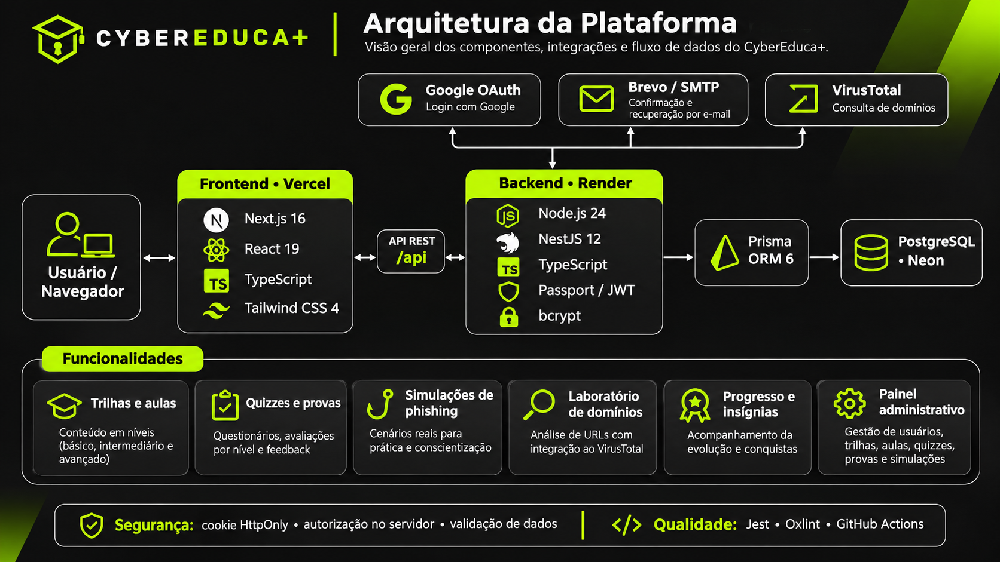

# CyberEduca+

> Plataforma web de aprendizagem em cibersegurança, desenvolvida como Projeto Final de Curso (PFC) na Universidade de Mogi das Cruzes — UMC.


**Site:** [cybereduca.vercel.app](https://cybereduca.vercel.app)

## Índice

- [Sobre o projeto](#sobre-o-projeto)
- [Integrantes](#integrantes)
- [Funcionalidades](#funcionalidades)
- [Arquitetura e tecnologias](#arquitetura-e-tecnologias)
- [Executar localmente](#executar-localmente)
- [Verificação](#verificação)
- [Segurança e privacidade](#segurança-e-privacidade)
- [Organização do repositório](#organização-do-repositório)
- [Documentação complementar](#documentação-complementar)
- [Metodologia](#metodologia)
- [Uso acadêmico e recursos de terceiros](#uso-acadêmico-e-recursos-de-terceiros)

## Sobre o projeto


O CyberEduca+ reúne trilhas, aulas, quizzes, provas por nível, simulações e um laboratório de consulta de domínios. O aluno estuda, pratica, acompanha seu progresso e conquista insígnias. O administrador gerencia os conteúdos e acompanha os resultados da plataforma.

O projeto foi finalizado como PFC dos cursos de Bacharelado em Engenharia de Software e Bacharelado em Sistemas de Informação da UMC. A interface web é responsiva, com navegação adaptada para computadores e celulares.

**Objetivo:** oferecer capacitação acessível em segurança da informação, aproximando os conteúdos de situações do cotidiano e permitindo acompanhar a evolução do aprendizado.

<br clear="right"/>

## Integrantes

| Nome completo | RGM |
|---|---|
| Luís Felipe Penninck Dos Santos | 11231101140 |
| Caio Miranda do Nascimento | 11231101833 |
| Thiago dos Santos Soares | 11221101451 |

**Orientador:** Alessandro Aparecido da Silva Horas.

## Funcionalidades

### Aluno

- Cadastro e login com senha, seguido de confirmação por link de uso único enviado por e-mail.
- Entrada com Google, quando a integração está configurada no ambiente.
- Recuperação de senha por e-mail.
- Dashboard com progresso e acesso à próxima aula.
- Trilhas organizadas nos níveis básico, intermediário e avançado, com percurso horizontal e acompanhamento das aulas concluídas.
- Aulas com textos, materiais de apoio, mídias e atividades conforme o conteúdo cadastrado.
- Provas ao final de cada nível: conclusão das aulas e aprovação com pelo menos 60% de acertos para conquistar a insígnia e liberar o nível seguinte.
- Nova tentativa de prova após 24 horas em caso de reprovação.
- Quizzes com correção e feedback.
- Simulações de phishing e outros cenários de segurança, com decisões, correção no servidor e resultados salvos. O catálogo exibe até oito simulações por página.
- Laboratório para consulta de domínios com integração ao VirusTotal.
- Perfil com conquistas e indicadores de desempenho; configurações de nome, e-mail, foto, avatar e senha, além de exclusão da conta.

### Administração

- Dashboard com indicadores de usuários, trilhas, aulas, atividades e desempenho educacional.
- Gestão de usuários, trilhas, aulas, quizzes, provas e simulações.
- Publicação e arquivamento de conteúdos conforme o módulo.
- Consulta de resultados e histórico de operações administrativas.
- Acesso restrito à conta administradora oficial, com validação de permissões no backend.

### Área pública

- Página inicial com apresentação da plataforma e notícias de cibersegurança.
- Páginas Sobre, Ajuda, Termos de Uso e Política de Privacidade.
- Banner de boas-vindas na primeira visita à página inicial; o navegador lembra seu fechamento.
- Escolha de cookies opcionais, com possibilidade de aceitar, rejeitar e alterar a decisão posteriormente. A preferência controla o armazenamento local das celebrações de conquistas já exibidas.

## Arquitetura e tecnologias



O navegador acessa o frontend em Next.js. As requisições para `/api` são encaminhadas ao backend em NestJS, que aplica autenticação, permissões, validação, correção das atividades e auditoria. O Prisma realiza o acesso ao PostgreSQL.

O Prisma integra o backend como camada de acesso a dados, sem constituir um serviço separado. No laboratório, a consulta ao VirusTotal utiliza apenas o domínio, não uma URL completa. As simulações representam situações do cotidiano em cenários fictícios de treinamento, sem executar ataques reais.

A sessão utiliza um JWT em cookie HttpOnly. Os gabaritos e as regras de desbloqueio são tratados no servidor. Consultas idênticas simultâneas no navegador compartilham uma requisição, sem manter as respostas concluídas em um cache permanente.

| Camada | Tecnologias e serviços |
|---|---|
| Frontend | Next.js 16, React 19, TypeScript, Tailwind CSS 4, CSS, Base UI, shadcn, Lucide, React Markdown e Recharts |
| Backend | Node.js 24, NestJS 12, TypeScript, Passport, JWT, bcrypt e validação de DTOs |
| Dados | PostgreSQL e Prisma ORM 6; banco de produção no Neon |
| Integrações | Google OAuth, Brevo ou SMTP para e-mails e VirusTotal para consulta de domínios |
| Publicação | Vercel para o frontend e Render para o backend |
| Qualidade | Jest, testes de integração HTTP, verificações do frontend e Oxlint; GitHub Actions em pull requests para a main |

## Executar localmente

### Requisitos

- Node.js 24, conforme [.nvmrc](./.nvmrc), e npm.
- PostgreSQL e um banco criado para a aplicação.
- Configuração de envio de e-mail para concluir o login com senha e a recuperação de acesso.

Execute os comandos de cada serviço em terminais separados. Os exemplos abaixo usam PowerShell.

### Backend

Antes da primeira execução, crie `backend/.env` a partir de [backend/.env.example](./backend/.env.example) e configure `DATABASE_URL`, `JWT_SECRET`, `FRONTEND_URL` e o envio de e-mails. Use Brevo ou SMTP; o login depende da entrega do link de confirmação. Google OAuth e VirusTotal exigem suas próprias credenciais para habilitar essas integrações.

```powershell
cd backend
npm install
npx prisma generate
npx prisma migrate deploy
npm run start:dev
```

A API utiliza `http://localhost:3002` por padrão. A variável `PORT` permite alterar a porta.

`npx prisma migrate deploy` aplica as migrações pendentes, incluindo as atualizações versionadas do catálogo. Não altere migrações já aplicadas. Os comandos `db:seed` são ferramentas de importação e manutenção; o seed geral também atualiza conteúdos e estrutura das trilhas, portanto não deve ser executado indiscriminadamente em produção.

### Frontend

Antes da primeira execução, crie `frontend/.env.local` a partir de `frontend/.env.local.example`, com `BACKEND_URL=http://localhost:3002`, ou o endereço correspondente à sua API.

```powershell
cd frontend
npm install
npm run dev
```

O site fica disponível em `http://localhost:3001`.

Mais detalhes do backend estão em [backend/README.md](./backend/README.md).

## Verificação

Na pasta `backend`:

```powershell
npm test -- --runInBand
npm run lint
npm run build
```

Para os testes de integração, configure `.env.test.local` conforme [backend/.env.test.example](./backend/.env.test.example) e execute `npm run test:integracao`. O executor exige PostgreSQL local e cria um banco temporário, separado do banco da aplicação.

Na pasta `frontend`:

```powershell
npx tsc --noEmit --incremental false
npm run build
node scripts/test-inflight-requests.cjs
node scripts/test-request-loading.cjs
node scripts/test-mobile-public-menu.cjs
node scripts/test-admin-dashboard.cjs
node scripts/test-admin-lesson-editor.cjs
```

As verificações do frontend cobrem requisições, carregamento, navegação mobile, cálculos do dashboard e edição de aulas. Outros scripts de verificação estão em `frontend/scripts` e `backend/scripts`.

## Segurança e privacidade

- Senhas armazenadas como hash bcrypt; credenciais de integração permanecem em variáveis de ambiente.
- Cookie de sessão HttpOnly, com SameSite=Lax e Secure em produção, válido por até 24 horas.
- Links de confirmação de login válidos por cinco minutos e de recuperação de senha por quinze minutos, ambos de uso único.
- Autorização administrativa e validação de entradas no backend.
- Gabaritos e correção das atividades no servidor, com controles contra envios duplicados nos fluxos protegidos por transação.
- Limitação de login por janela de quinze minutos: cinco tentativas por e-mail e trinta por IP. Os contadores são mantidos por processo; múltiplas instâncias exigem armazenamento compartilhado.
- Registros de auditoria e controles para atualização e exclusão da conta.
- Preferência de cookies guardada por 180 dias no navegador; fechamento das boas-vindas lembrado por um ano. Rejeitar opcionais preserva o acesso e o progresso da conta.

Fontes e conteúdos externos podem realizar conexões com seus fornecedores. A barra de cookies não representa um bloqueio geral dessas conexões. As informações de tratamento de dados e os canais de contato estão na Política de Privacidade do site.

## Organização do repositório

| Pasta | Conteúdo |
|---|---|
| `frontend/` | Interface, páginas públicas, área do aluno e painel administrativo |
| `backend/` | API, regras de negócio, testes, Prisma e ferramentas de manutenção |
| `assets/` | Imagens de apresentação do projeto |
| `docs/` | Documentos acadêmicos, modelagem e referências técnicas |
| `.github/` | Fluxo de integração contínua e modelo de pull request |

## Documentação complementar

| Documento | Conteúdo |
|---|---|
| [Ficha do PFC — UMC](./docs/Ficha_PFC_UMC.docx) | Ficha acadêmica do Projeto Final de Curso |
| [Monografia](./docs/MONOGRAFIA.docx) | Monografia do CyberEduca+ |
| [Resumo expandido](./docs/Resumo_Expandido_CyberEduca.docx) | Resumo expandido do projeto |
| [Backend](./backend/README.md) | Configuração, execução e verificação da API |
| [Provas por nível](./docs/certificacoes-niveis.md) | Critérios de aprovação, tentativas e desbloqueio dos níveis |
| [Módulo de aulas](./docs/modulo-aulas.md) | Conteúdos e funcionamento das aulas |

## Metodologia

O desenvolvimento utilizou Scrum, com gestão de tarefas via Monday e comunicação da equipe por Discord e WhatsApp. A modelagem foi realizada com UML, DER e protótipos de interface no Figma.

## Uso acadêmico e recursos de terceiros

Projeto desenvolvido para a Universidade de Mogi das Cruzes — UMC, em Mogi das Cruzes — SP, 2026. Bibliotecas, APIs, imagens e demais recursos de terceiros permanecem sujeitos às respectivas licenças e condições de uso.

Atualizado em 16 de novembro de 2026.
